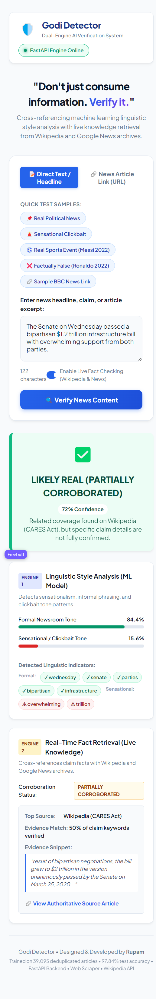
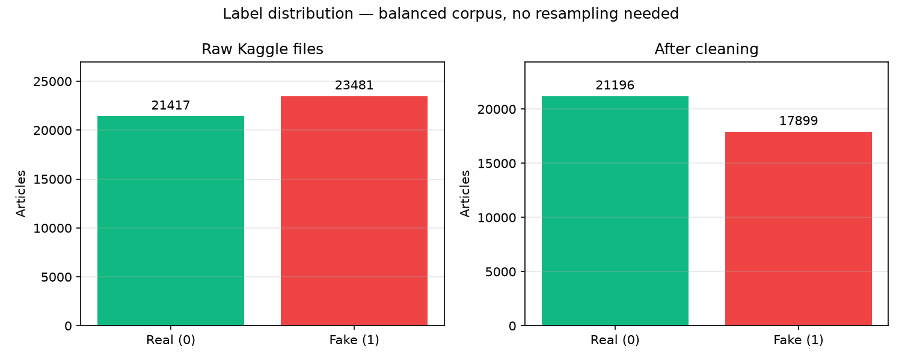
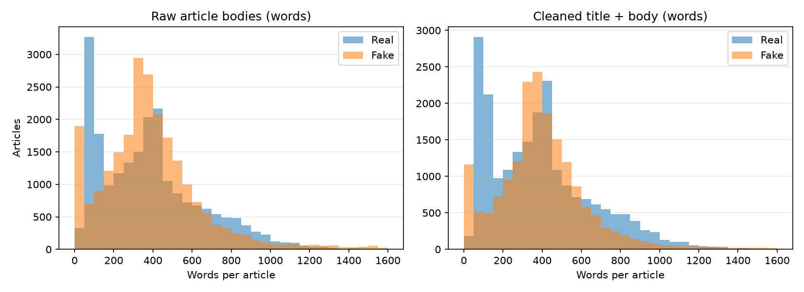
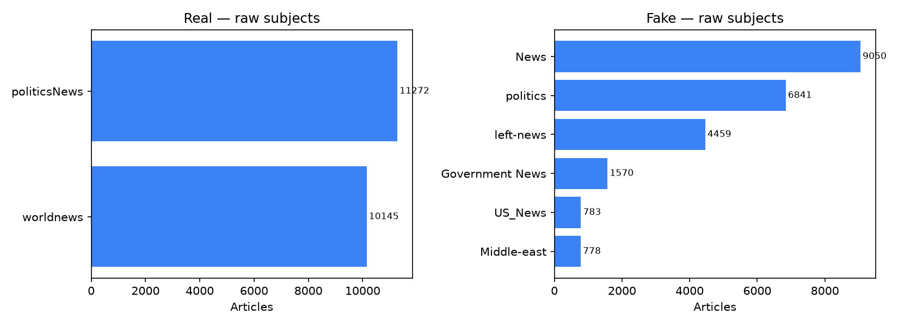
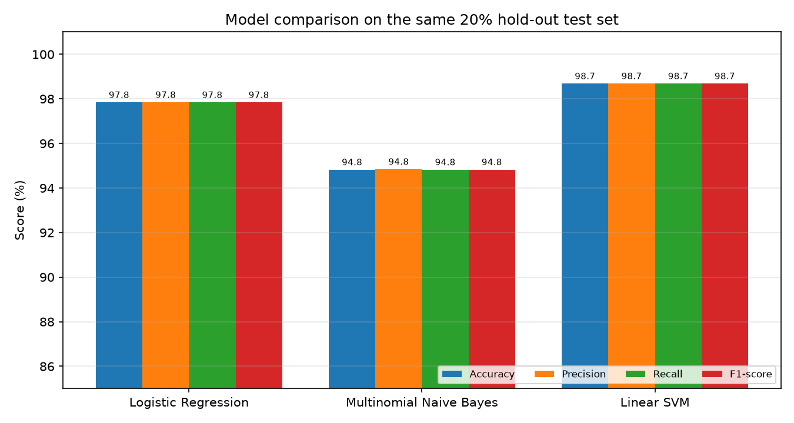
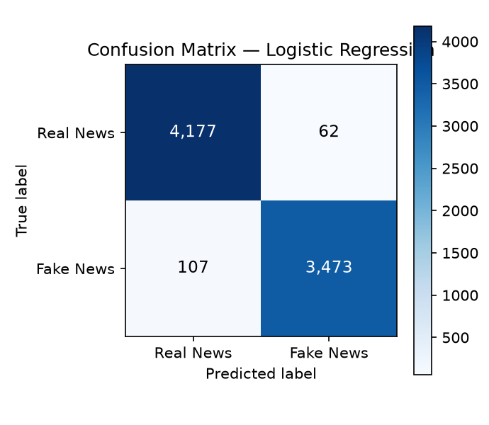
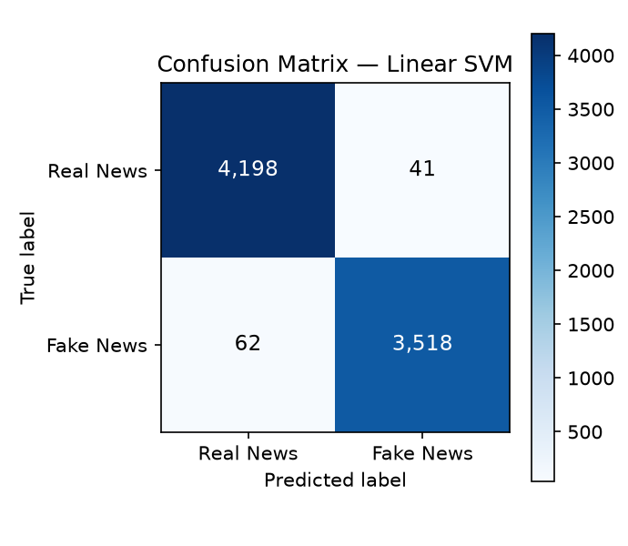

# 🛡️ Godi Detector

> *"Don't just consume information. Verify it."*

A dual-engine fake-news and claim verifier. It combines a supervised style
classifier with live evidence retrieval, so a verdict reflects both *how* a text
is written and *whether* public records and news archives support it.



| Engine | What it does | Backed by |
|---|---|---|
| **Engine 1 — Style** | Predicts `real` vs `fake/clickbait` from vocabulary and phrasing, and reports the tokens that drove the decision | TF-IDF (1–2 grams, 50k features) + Logistic Regression, trained on 39,095 articles — **97.84% test accuracy** |
| **Engine 2 — Evidence** | Retrieves live Wikipedia summaries and Google News RSS items, then checks whether one authoritative sentence actually contains the claim | Wikipedia REST/Search API, Google News RSS |

Three front ends share one pipeline: a **FastAPI web app** (`static/`), a
**Streamlit app** (`app.py`), and a **terminal verifier** (`predict.py`).

---

## 📌 Problem statement

Misinformation spreads faster than manual fact-checking can keep up. Professional
verification is slow, expert-dependent and does not scale to the volume of text
published every day. At the same time, most readers judge credibility from
surface cues — an authoritative tone, a sensational headline — which are cheap
to imitate.

Two signals are individually weak:

- **Writing style** is available for any text instantly, but style is not truth:
  formal prose can be false, and a terse true statement can look suspicious.
- **Live evidence retrieval** is authoritative when it finds something, but it
  fails silently for recent, local or niche claims.

The project asks whether these two signals can be combined into a single,
transparent verdict that is honest about what it does and does not know.

## 🎯 Objectives

1. Build a reproducible text-classification pipeline that separates formal
   newsroom prose from clickbait/sensational articles.
2. Train and **compare at least three** standard algorithms on one identical
   dataset, split and feature space, and select the deployed model on measured
   evidence rather than assumption.
3. Remove label leakage (wire-service tags, image credits) so the classifier
   learns style rather than the publisher's name.
4. Pair the classifier with live evidence retrieval, and let evidence override
   style.
5. Ship a working prototype — web API, Streamlit UI and CLI — that explains its
   verdict instead of only printing a label.
6. Be explicit that a prediction is decision support, **not** proof of truth.

---

## 🧭 How a verification runs

```
input (headline / excerpt / article URL)
  │
  ├─ URL?  ──► scraper.py: fetch, extract title + first 12 paragraphs
  │
  ├─► Engine 1  classifier.predict_proba → real % / fake % + contributing tokens
  │
  ├─► Engine 2  fact_checker.verify_claim_evidence
  │      1. direct contradiction check on authoritative event records
  │      2. Wikipedia search (up to 4 pages) + Google News RSS (up to 5 items)
  │      3. sentence-level co-occurrence scoring of the claim against evidence
  │
  └─► synthesis → verdict, category (real / fake / warn), confidence, explanation
```

Evidence overrides style: a claim that contradicts a known record is reported as
debunked even if it is written in formal newsroom prose. The rule table lives in
one place — `utils.decide_verdict()` — so the API, Streamlit app and CLI cannot
drift apart.

### Verdicts

| Verdict | Category | Trigger |
|---|---|---|
| `DEBUNKED / FACTUALLY FALSE` | fake | Engine 2 found a direct contradiction (≥ 96% confidence) |
| `VERIFIED REAL NEWS` | real | Engine 2 corroborated the claim (≥ 88%) |
| `LIKELY REAL (PARTIALLY CORROBORATED)` | real | Partial evidence and formal tone (real ≥ 60%) |
| `UNVERIFIED / REQUIRES CAUTION` | warn | Partial evidence but informal tone |
| `PARTIALLY VERIFIED (BELOW STRICTNESS THRESHOLD)` | warn | Streamlit only: corroborated evidence under the sidebar strictness slider |
| `LIKELY FAKE NEWS / CLICKBAIT` | fake | No evidence and fake-style probability ≥ 70% |
| `UNVERIFIED CLAIM (FORMAL JOURNALISTIC TONE)` | warn | No evidence, real ≥ 75% |
| `AMBIGUOUS / UNVERIFIED` | warn | No evidence, neutral style (50%) |

Engine 2 statuses are `CORROBORATED` (match ≥ 0.55), `PARTIALLY_CORROBORATED`
(≥ 0.35), `NO_EVIDENCE`, plus `CONTRADICTED` from the direct-record check.
Engine 1's probabilities are always returned separately so the two signals can
be read independently.

---

## 📊 Dataset

**Source:** the [Fake and Real News Dataset](https://www.kaggle.com/datasets/clmentbisaillon/fake-and-real-news-dataset)
(ISOT, University of Victoria), a widely used fake-news benchmark.

| File | Rows | Content |
|---|---|---|
| `data/raw/True.csv` | 21,417 | Real articles, Reuters wire copy (2016–2017) |
| `data/raw/Fake.csv` | 23,481 | Fake/clickbait articles scraped from unreliable sites |

Columns (both files): `title`, `text`, `subject`, `date`. Target label is derived
from the file: **0 = real, 1 = fake**.

### Download

The CSVs are ~110 MB and are **not committed** (see `.gitignore`). Download the
dataset from Kaggle, then place the files as:

```
data/raw/True.csv
data/raw/Fake.csv
```

Then regenerate the prepared dataset:

```bash
python prepare_data.py     # writes data/processed/news_dataset.csv + results/dataset_stats.json
```

### Measured dataset size

| Stage | Articles |
|---|---|
| Raw `True.csv` | 21,417 |
| Raw `Fake.csv` | 23,481 |
| **Combined, before cleaning** | **44,898** |
| Duplicates removed | 5,802 |
| Empty/trivial rows removed (< 20 chars) | 1 |
| **Prepared corpus** | **39,095** |
| — Real (label 0) | 21,196 (54.22%) |
| — Fake (label 1) | 17,899 (45.78%) |

There are **no missing values** in either raw file. Raw duplicate rows are 206 in
`True.csv` and 3 in `Fake.csv`; the larger 5,802 figure is duplicate *content*
after title + body are combined, which catches near-identical articles with
different titles.

The corpus is close to balanced (54/46), so no resampling or class weighting is
applied. The numbers above are the actual values printed by `prepare_data.py`
and stored in `results/dataset_stats.json`.

---

## 🧹 Preprocessing

`prepare_data.py` runs one deterministic pipeline:

1. **Load & label** both files (`label` 0/1).
2. **Remove label leakage** — the single most important step:
   - every `True.csv` body starts with a Reuters dateline
     (`WASHINGTON (Reuters) - …`) and contains wire tags, which would let a model
     classify by publisher rather than by style. These are stripped, including
     `Reuters/Ipsos` constructions and possessive forms.
   - fake articles often end with CMS image credits
     (`Featured image: YouTube`, `Photo by …/Getty Images`). These are removed.
   - URLs, `pic.twitter.com/…` links and whitespace are normalized.
   - The same `clean_text()` is applied to **both** classes, so no class-specific
     artifact survives that the other class lacks.
3. **Combine** `title + " " + text` into `content`.
4. **Deduplicate** on `content` and drop articles ≤ 20 characters.
5. **Shuffle** with `random_state=42`.

The pipeline is deliberately conservative: it does not lowercase, stem, remove
punctuation or hand-strip numbers in the raw text. Case, negation and sentence
structure are meaningful for style detection, and the TF-IDF vectorizer performs
the tokenization and stop-word removal itself.

---

## 🔍 Exploratory data analysis

Run `python explore_data.py` to regenerate the figures and
`results/eda_summary.json`.

| Figure | What it shows |
|---|---|
|  | Class balance before and after cleaning — no resampling needed |
|  | Word counts per class; long-tailed, similar medians (~360 words) |
|  | Raw Kaggle subject categories; real articles are only `politicsNews`/`worldnews`, fake ones span five categories |

Measured article length (words):

| Split | Real | Fake |
|---|---|---|
| Raw body — mean | 385.64 | 423.20 |
| Raw body — median | 359 | 363 |
| Raw body — 90th percentile | 775 | 709 |
| Cleaned `content` — mean | 391.03 | 425.91 |
| Cleaned `content` — median | 364 | 381 |

Observations:

- The corpus is balanced and needs no resampling.
- Both classes have similar length distributions, so length is not a shortcut
  the model can exploit — the classifier has to use vocabulary and phrasing.
- `subject` is **not** used as a feature. It is perfectly correlated with the
  label in this dataset and would be textbook leakage.
- The `date` column is unusable for fake articles (some rows contain a URL
  instead of a date), and is not used for modelling either.

---

## 🤖 Algorithms implemented and compared

Three standard text-classification algorithms, all trained through the same
pipeline (`train_model.py`):

| # | Algorithm | Configuration |
|---|---|---|
| 1 | **Logistic Regression** | `max_iter=1000`, `random_state=42`, L2 penalty |
| 2 | **Multinomial Naive Bayes** | `alpha=0.1` (Laplace smoothing) |
| 3 | **Linear SVM** | `LinearSVC`, `random_state=42` |

Why these three:

- They are the established baselines for high-dimensional sparse text and are
  fast enough to retrain on the full corpus in minutes.
- They behave differently: LR is a linear probabilistic model, NB is a
  generative count model, Linear SVM optimizes the margin directly and often
  wins on accuracy.
- All three are interpretable at the token level, which the UI needs (`explain_style()`).

---

## 🧮 TF-IDF feature extraction

One vectorizer configuration, fitted **on the training split only**:

```python
TfidfVectorizer(
    stop_words="english",
    max_features=50000,
    ngram_range=(1, 2),
    min_df=2,
)
```

- **Unigrams + bigrams** capture both vocabulary ("shocking") and short phrases
  ("featured image", "watch here").
- **`min_df=2`** drops tokens that appear once, which are mostly typos or
  names that cannot generalize.
- **50,000 features** is the fitted vocabulary size — the corpus produces at
  least that many candidates.
- The fitted vectorizer is stored **inside the saved scikit-learn `Pipeline`**,
  so the API, Streamlit app and CLI apply exactly the same feature extraction
  as training. There is no second vectorizer to drift out of sync.

---

## 🧪 Experimental setup

| Item | Value |
|---|---|
| Dataset | `data/processed/news_dataset.csv` — 39,095 cleaned articles |
| Split | 80/20 stratified hold-out: 31,276 train / 7,819 test |
| Random state | `42` (split and classifiers) |
| Features | shared TF-IDF matrix, 31,276 × 50,000 |
| Metrics | accuracy, weighted precision/recall/F1, fake-class precision/recall/F1, confusion matrix, Brier score, log loss |
| Hardware | single CPU, no GPU |

The test split is never used for fitting or feature selection. Because the
vectorizer is fitted only on the training split, there is no vocabulary leakage
from the test set.

Reproduce with:

```bash
python prepare_data.py
python train_model.py     # ~2 s of classifier training after ~40 s of TF-IDF
```

---

## 📈 Results

All values below come from `results/metrics.json`, produced by the run on
2026-11-24 on the 39,095-article corpus.

| Model | Accuracy | Precision (w) | Recall (w) | F1 (w) | F1 (fake) | Brier ↓ | Log loss ↓ | Train |
|---|---|---|---|---|---|---|---|---|
| **Linear SVM** | **98.68%** | 98.68% | 98.68% | **98.68%** | 98.56% | — | — | 0.41 s |
| **Logistic Regression** ← deployed | 97.84% | 97.84% | 97.84% | 97.84% | 97.62% | **0.0218** | **0.1049** | 0.25 s |
| Multinomial Naive Bayes | 94.82% | 94.84% | 94.82% | 94.82% | 94.40% | 0.0399 | 0.1541 | 0.02 s |



### Confusion matrices (rows = true, cols = predicted)

| Model | Real→Real | Real→Fake | Fake→Real | Fake→Fake |
|---|---|---|---|---|
| Logistic Regression | 4,177 | 62 | 107 | 3,473 |
| Multinomial Naive Bayes | 4,002 | 237 | 168 | 3,412 |
| Linear SVM | 4,198 | 41 | 62 | 3,518 |

| | |
|---|---|
|  |  |

Full per-class reports: `results/classification_report_*.txt`.

### Observations

1. **All three models are strong.** Even the weakest (Naive Bayes, 94.82%)
   confirms that vocabulary and phrasing carry a large amount of signal in this
   corpus.
2. **Linear SVM is the most accurate** (98.68%), 0.84 percentage points ahead of
   Logistic Regression, and it makes 107 fewer errors out of 7,819 test
   articles. Its errors are symmetric (41 + 62).
3. **Naive Bayes is the weakest but not by a little**: it produces 405 false
   positives on real news (237) and fake news (168). Independence assumptions
   fit bigram counts badly.
4. **Both classes are classified well**, with no sign of a degenerate model that
   simply predicts the majority class.
5. **Errors are mostly stylistic near-misses.** Real articles written in a
   punchy style and fake articles written in a wire-service register are where
   the model fails, which is exactly why the system also retrieves evidence.
6. Logistic Regression's probabilities are informative, not just confident
   labels: Brier 0.0218 and log loss 0.1049 mean predicted probabilities are
   close to observed frequencies. Naive Bayes is worse calibrated (0.0399).

### Model selection

**Deployed model: Logistic Regression (97.84%).**

Linear SVM is the best pure classifier, but `LinearSVC` exposes only an
uncalibrated decision margin — not a probability. The prototype displays a
confidence score, and presenting a margin as a percentage would be misleading
(this project's evaluation criteria explicitly forbid that). Between the two
models that output genuine `predict_proba` probabilities, Logistic Regression
is clearly the better one (97.84% vs 94.82% F1, Brier 0.0218 vs 0.0399), and its
coefficients already power the token explanations in `explain_style()`.

The 0.84-point accuracy difference is the price of an honest, interpretable
confidence score. A calibrated SVM (`CalibratedClassifierCV`) is listed under
[future improvements](#-future-improvements) as the way to close that gap
without giving up probabilities.

`models/model_meta.json` records `algorithm`, all four headline metrics and the
comparison table, and the API/Streamlit read it at request time.

---

## 🖥️ Prototype


The FastAPI web app supports both input modes:

1. **Paste text or a headline**, or **paste an article URL** (scraped server-side).
2. Press **Verify News Content**.
3. Get a verdict banner (`real` / `fake` / `warn`), a confidence score, and the
   reason in plain language.
4. Inspect each engine separately: style probabilities and the exact tokens that
   pushed the decision, plus the evidence status, top source, match ratio,
   snippet and a link to the source.

The Streamlit app offers the same two engines plus a **strictness threshold**
slider for the evidence check. Every surface repeats the same caveat: this is
decision support, not proof.

---

## 🛠️ Technology stack

- **Language:** Python 3.13
- **ML:** scikit-learn (TF-IDF, Logistic Regression, Multinomial NB, LinearSVC, metrics), joblib
- **Data:** pandas, NumPy
- **Visualization:** Matplotlib
- **Backend:** FastAPI + Uvicorn, Pydantic validation
- **Frontend:** HTML/CSS/vanilla JavaScript served by FastAPI; Streamlit for the second UI
- **Scraping/retrieval:** requests, BeautifulSoup4, Wikipedia API, Google News RSS
- **Testing:** pytest (99 tests)

---

## 📁 Project structure

```
Godi Detector/
├── api.py               # FastAPI backend: /api/status, /api/verify, /api/scrape, serves static/
├── app.py               # Streamlit UI (port 8501)
├── predict.py           # Terminal verifier (interactive + one-shot argument)
├── fact_checker.py      # Engine 2: Wikipedia + Google News retrieval and scoring
├── scraper.py           # News URL scraper + SSRF guard (_safe_get / validate_public_url)
├── utils.py             # decide_verdict(), explain_style(), load_model_meta()
├── prepare_data.py      # Cleaning, leakage removal, deduplication → dataset + stats
├── train_model.py       # Trains/compares 3 algorithms → results/ + models/
├── explore_data.py      # EDA figures + measured summary
├── requirements.txt
├── .env.example         # Copy to .env
├── conftest.py          # Puts the project root on sys.path for pytest
├── tests/
│   ├── test_verdict.py       # verdict rule table, thresholds, slider overrides
│   ├── test_model_meta.py    # metadata reader and its fallbacks
│   ├── test_ssrf.py          # URL guard, redirect re-validation, response cap
│   └── test_pipeline.py      # cleaning, dataset build, 3 algorithms, metrics, pickle round-trip
├── results/             # Committed experiment artefacts
│   ├── dataset_stats.json
│   ├── eda_summary.json
│   ├── eda_*.png
│   ├── metrics.json
│   ├── model_comparison.csv
│   ├── model_comparison.png
│   ├── confusion_matrix_*.png
│   └── classification_report_*.txt
├── docs/
│   └── prototype-web.png
├── static/              # Web frontend (index.html, style.css, app.js)
├── models/
│   ├── godi_news_classifier.pkl          # Latest model (gitignored)
│   ├── godi_news_classifier_<ts>.pkl     # Versioned snapshots (gitignored)
│   └── model_meta.json                   # metrics + algorithm + comparison (tracked)
└── data/                # Not in git
    ├── raw/             # True.csv, Fake.csv
    └── processed/       # news_dataset.csv (~189 MB)
```

Everything is path-relative and must be run from the project root.

---

## ⚙️ Setup

### Requirements
- **Python 3.12 or 3.13.** Python 3.14 fails on machines with Windows Smart App
  Control enabled: it blocks `pydantic_core`'s compiled extension
  (`_pydantic_core.cp314-win_amd64.pyd`). Use 3.13 unless Smart App Control is off.
- ~900 MB of disk for the environment, plus ~300 MB for the dataset if you retrain.

### 1. Create and activate a virtual environment

The folder is `.venv`, not `venv`:

```bash
# Windows
py -3.13 -m venv .venv
.venv\Scripts\activate

# macOS / Linux
python3.13 -m venv .venv
source .venv/bin/activate
```

### 2. Install dependencies

```bash
pip install -r requirements.txt
```

### 3. Configure the environment

```bash
# Windows
copy .env.example .env

# macOS / Linux
cp .env.example .env
```

Defaults work for local development. `.env` is gitignored — never commit it.

### 4. Get a model

The trained `.pkl` is not committed. Either use the one already in `models/`,
or run the two commands under [Training](#-training-and-reproduction).

---

## 🚀 Running

### Option A — FastAPI web app (recommended)

```bash
uvicorn api:app --reload --host 127.0.0.1 --port 8000
```

Open <http://localhost:8000>.

> **First start after a fresh install can take up to a minute.** The first
> `joblib.load` makes Windows scan the newly installed scikit-learn/numpy
> binaries (slower with Smart App Control on). Afterwards the model unpickles in
> ~1.5 s and the server is ready in 5–10 s. Wait for `Model loaded successfully!`
> and `Application startup complete.` before sending requests.

### Option B — Streamlit UI

```bash
streamlit run app.py
```

Serves on <http://localhost:8501>. Same engines, sidebar shows live model
metadata and the strictness slider.

### Option C — Terminal verifier

```bash
python predict.py                      # interactive loop; 'exit' or Ctrl+C to quit
python predict.py "NASA rover Perseverance landed on Mars in February 2021"
```

### Utilities

```bash
python scraper.py https://www.bbc.com/news    # test article extraction
python fact_checker.py "claim to check"       # test Engine 2 alone
python explore_data.py                        # regenerate EDA figures
```

---

## 🔁 Training and reproduction

```bash
python prepare_data.py    # data/raw/*.csv → data/processed/news_dataset.csv + results/dataset_stats.json
python train_model.py     # trains 3 models → results/* + models/*.pkl + models/model_meta.json
python explore_data.py    # EDA figures + results/eda_summary.json
```

`train_model.py` prints each model's classification report and confusion matrix,
writes the comparison CSV/JSON/plots, then saves the selected pipeline as:

- `models/godi_news_classifier.pkl` — always the latest
- `models/godi_news_classifier_<YYYYMMDD_HHMMSS>.pkl` — immutable snapshot
- `models/model_meta.json` — algorithm, accuracy/F1/precision/recall, sizes,
  vectorizer settings and the comparison table

The API and Streamlit read `model_meta.json` per request, so numbers update
without a restart. The `.pkl` is loaded once at startup — restart `uvicorn`
after retraining.

---

## ✅ Testing

```bash
python -m pytest tests -q
```

99 tests, all offline (no network, no 196 MB dataset required — the ML tests
build a synthetic corpus with the same schema):

| Test file | Covers |
|---|---|
| `tests/test_pipeline.py` | text sanitization (datelines, wire tags, credits, URLs), dataset construction and real before/after counts, missing-value handling, all **three algorithms**, metric correctness against the confusion matrix, calibration metrics, model selection, pickle round-trip, and that the saved pipeline uses the same TF-IDF settings |
| `tests/test_verdict.py` | every verdict branch, the 96/88/60/70/75 thresholds, slider overrides, result shape |
| `tests/test_model_meta.py` | metadata happy path, missing/malformed/non-object files |
| `tests/test_ssrf.py` | loopback/private/metadata URLs, integer/hex/NAT64 IPv6 forms, mixed DNS answers, redirect re-validation, 5 MB response cap |

Manual checks performed on the final build: API `/api/status` returns the
retrained model and 97.84% accuracy, `/api/verify` returns the full 7-key
payload for real and clickbait samples, `/api/scrape` extracts a live BBC
article, and the SSRF guard rejects `127.0.0.1`, `169.254.169.254` and `[::1]`
with `400`.

---

## 🌐 API

Base URL `http://localhost:8000`. No authentication — intended for local use.

| Method | Path | Purpose |
|---|---|---|
| `GET` | `/` | Serves `static/index.html` |
| `GET` | `/static/*` | Frontend assets |
| `GET` | `/api/status` | Health check + model metadata |
| `POST` | `/api/verify` | Verify text or a URL with both engines |
| `POST` | `/api/scrape` | Extract an article's title and body from a URL |
| `GET` | `/docs` | Generated OpenAPI docs (FastAPI default) |

### `GET /api/status`

```json
{
  "status": "online",
  "model_loaded": true,
  "engine_1": "TF-IDF + Logistic Regression",
  "engine_2": "Real-Time Wikipedia & Google News Retrieval",
  "dataset_articles": 39095,
  "model_accuracy": 97.84
}
```

`dataset_articles` and `model_accuracy` are `null` when `model_meta.json` is
missing or unreadable. `engine_1` reflects the algorithm actually trained.

### `POST /api/verify`

```json
{
  "text": "NASA rover Perseverance landed on Mars in February 2021",
  "check_facts": true
}
```

- `text` — 3 to 20,000 characters; a headline, excerpt, claim, or `http(s)` URL.
  A URL is scraped first, then classified from title + body. Longer input is
  rejected with `422` rather than vectorised.
- `check_facts` — default `true`. Set `false` for a fast Engine 1-only pass.

```bash
curl -X POST http://localhost:8000/api/verify \
  -H "Content-Type: application/json" \
  -d '{"text": "NASA rover Perseverance landed on Mars in February 2021", "check_facts": true}'
```

Response:

```json
{
  "verdict": "VERIFIED REAL NEWS",
  "category": "real",
  "confidence": 88.0,
  "explanation": "Corroborated by Wikipedia. Authoritative public records confirm this claim.",
  "scraped_article": null,
  "engine_1_style": {
    "real_probability": 91.2,
    "fake_probability": 8.8,
    "real_signals": ["said", "percent"],
    "fake_signals": ["shocking", "watch"]
  },
  "engine_2_facts": {
    "status": "CORROBORATED",
    "confidence": 0.92,
    "top_source": "Wikipedia",
    "top_snippet": "...",
    "top_url": "https://en.wikipedia.org/wiki/...",
    "matched_keywords": ["nasa", "rover"],
    "missing_keywords": [],
    "match_ratio": 0.67,
    "total_evidence_count": 9
  }
}
```

`scraped_article` is populated (same shape as `/api/scrape`, minus `error`) when
the input was a URL. `engine_2_facts` is `null` when `check_facts` is `false`.

### `POST /api/scrape`

```json
{ "url": "https://www.bbc.com/news/articles/..." }
```

Returns `url`, `domain`, `title`, `content` (first 12 paragraphs), `preview`
(50 words), and `word_count`. It strips `script`/`style`/`nav`/`header`/`footer`
boilerplate and drops paragraphs under 40 characters or containing cookie,
subscribe or newsletter text.

The body is streamed and truncated at **5 MB**, so a huge or malicious page
cannot exhaust server memory; the text an article needs sits near the top of the
document. Non-200 responses are never read.

### Errors

| Status | When |
|---|---|
| `400` | Invalid or unsafe URL, non-200 from the target site, no extractable text, empty text |
| `422` | Request body failed validation (`text` under 3 or over 20,000 characters, a URL over 2,048 characters) |
| `500` | `/api/verify` called while no model is loaded — run `train_model.py` |

---

## 🔧 Configuration (`.env`)

| Variable | Default | Description |
|---|---|---|
| `ALLOWED_ORIGINS` | `*` | Comma-separated CORS origins. Use `*` for local dev only |
| `MODEL_PATH` | `models/godi_news_classifier.pkl` | Model file; `model_meta.json` is read from the same directory |
| `LOG_LEVEL` | `info` | Uvicorn log level: `debug`, `info`, `warning`, `error` |

---

## 🔒 Security notes

- **SSRF guard on `/api/scrape` and URL input to `/api/verify`.** Because the
  server fetches a caller-chosen URL, `scraper.py` validates every hop:
  `http`/`https` only, hostname blocklist (`localhost`, `*.local`, `*.internal`,
  cloud metadata names), and the resolved IP must be globally routable.
  Embedded IPv4 (NAT64 `64:ff9b::/96`, 6to4 `2002::/16`) and integer/hex forms
  like `2130706433` are unwrapped and checked. Redirects are followed manually
  (max 5) so a public URL cannot bounce to a private one. Blocked requests
  return `400` with a plain-language reason.
- **No authentication.** The API is meant for `127.0.0.1`. Binding to `0.0.0.0`
  publishes an unauthenticated scraping and verification endpoint to your LAN.
- **CORS.** `ALLOWED_ORIGINS=*` is for development. Set the exact origin before
  exposing the service, and keep `allow_credentials=False`.
- **Secrets.** `.env` is gitignored. It currently holds no credentials.

### Known limitation

The guard validates the IP at request time but does not pin the resolved address
for the actual connection, so a hostile DNS server could in principle rebind
between check and connect (TOCTOU). This matters only for untrusted multi-user
deployments; for local use it is acceptable.

---

## 🧯 Troubleshooting

| Symptom | Cause / fix |
|---|---|
| `DLL load failed` on `pydantic_core` or `numpy` | Windows Smart App Control blocked the extension. Use Python 3.13 (see Setup). |
| `Warning: Model file '…' not found` | `models/godi_news_classifier.pkl` is missing. Run `train_model.py`, or set `MODEL_PATH`. |
| `/api/verify` returns `500` | Same as above — the classifier did not load; check the startup log. |
| First request takes a minute | One-time Windows antivirus scan of freshly installed binaries. |
| `error while attempting to bind on address` | Port 8000 is already in use — stop the other server or pass `--port 8001`. |
| `/api/scrape` says the site blocked the request | Non-200 response (paywall, bot check, redirect loop). |
| `/api/scrape` returns `400` "local, private, or internal address" | The URL failed the SSRF guard. Intentional. |
| Verdict says `NO_EVIDENCE` for a true claim | Wikipedia/Google News returned nothing usable, or the claim's wording does not co-occur in one authoritative sentence. Rephrase with the key entities. |
| Streamlit shows `unknown` accuracy | `models/model_meta.json` is missing or invalid; retrain or restore it. |
| `pytest` cannot import project modules | Run it from the project root; `conftest.py` adds the root to `sys.path`. |

---

## ⚠️ Limitations

- **Engine 1 classifies style, not truth.** It was trained on 2016–2017 Reuters
  wire copy versus clickbait sites, so it flags tone and register. Formal prose
  can still be false, and terse true statements can look suspicious.
- **Dataset bias is inherited.** Real articles are all Reuters; fake articles
  come from a specific set of sites. Performance on other outlets, other
  languages or post-2017 writing is not established by these numbers.
- **SVM comparison is not deployable as-is** without calibration (see model
  selection).
- **Engine 2 covers what Wikipedia and Google News happen to index.** Recent,
  local or niche claims often return no usable evidence, which maps to
  `AMBIGUOUS / UNVERIFIED` rather than a confident answer.
- **No held-out temporal split.** The split is random, so the same time period
  appears in train and test; a time-based split would be a stricter test of
  generalization.
- Verdicts are decision support, not fact-checking. Confirm anything
  consequential against a primary source.

---

## 🚧 Future improvements

- Calibrate the Linear SVM (Platt scaling / `CalibratedClassifierCV`) and
  re-compare it against Logistic Regression with probabilities intact.
- Add a chronological train/test split and report both, to separate style
  learning from topic/period memorization.
- Cross-validation and a small hyper-parameter search (`C`, `alpha`, `min_df`,
  `ngram_range`) instead of one fixed configuration.
- Add transformer baselines (DistilBERT/RoBERTa) and compare accuracy vs
  inference latency and model size.
- Cache Engine 2 lookups and add a second evidence provider (e.g. an
  fact-checking API) for claims outside news archives.
- Containerize the app and add CI (GitHub Actions running `pytest`).
- Rate limiting and authentication before any public deployment.

---

## 📄 License and author

Built by **Rupam** · Godi Detector Project.
Dataset: [Fake and Real News Dataset](https://www.kaggle.com/datasets/clmentbisaillon/fake-and-real-news-dataset)
(ISOT) — check the dataset's own license before redistribution.
